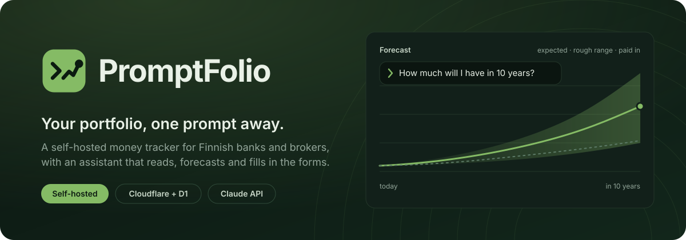

<p align="center">
  
</p>

# PromptFolio

A self-hosted portfolio and money tracker for a household that uses Finnish banks and brokers, with
an AI assistant built in.

You import your brokers' and banks' own exports. The app keeps one ledger, values everything in
euros, and answers: what is it worth, how has it done, where did the money go, how far has it
drifted from the plan, and where is it heading. The app is in English; the files it reads stay
Finnish.

It runs as one Cloudflare Worker with one D1 (SQLite) database. Nothing else to host.

## What you get

| Page          | What it shows                                                                                                                                      |
| ------------- | -------------------------------------------------------------------------------------------------------------------------------------------------- |
| **Dashboard** | Value, time- and money-weighted return, allocation, value over time, a weekly summary                                                              |
| **Holdings**  | Every holding: quantity, cost basis, value, gain, weight, yearly fund fee, price source                                                            |
| **Reconcile** | A broker's holdings statement against what the ledger says, with differences explained                                                             |
| **Cash**      | Bank accounts, balances, statement import, manual entries                                                                                          |
| **Debts**     | Add a student loan or credit card and its balances by hand; the Dashboard then shows net worth (owned minus owed) and keeps the before-debts chart |
| **Spending**  | Spending by category and payee, a flow of the year's money, month by month                                                                         |
| **Rebalance** | Target allocation, drift, where to put new money, fees per year                                                                                    |
| **Forecast**  | Your monthly plan and what the portfolio could be worth in 1 to 20 years                                                                           |
| **Tax**       | Per tax year: realised gains both permitted ways, dividends, equity savings accounts                                                               |
| **Chat**      | The assistant, also docked on every page: answers, forecasts, charts, confirmed changes                                                            |
| **Imports**   | Drop any export; the app works out what it is. History, with undo                                                                                  |

Light and dark themes. Every time chart has a hover ticker, and the value chart zooms by dragging.
Any chart, including one the assistant drew, exports as PNG or PDF.

## The AI parts

The rule everywhere: **the model proposes, the app checks, you decide.**

- **Imports without parsers.** A model reads a file layout once and writes a _recipe_ for it. The
  app checks the recipe against the file (for a bank statement, the rows must add up to the printed
  balance) and reuses it, so the same bank's next file needs no model call.
- **One drop box.** Drop any CSV or PDF; the app sorts each file to the right importer and account.
- **Rows a recipe could not read** come back prefilled. Every suggested number must appear in the
  row's own text, with the same sign.
- **Corporate actions** (splits, swaps, mergers) are explained from a web search and proposed as
  bookings. Quantities must match the broker's rows; a cost basis is never invented.
- **Price sources that find themselves.** Listed instruments come from Yahoo. For a fund, a model
  finds a page showing its price and writes a recipe for reading it; the page must show the fund's
  ISIN next to the price. Fund fees are looked up the same way.
- **The assistant** answers from the same figures the pages show, runs forecasts and what-ifs,
  draws charts in the conversation, and gives its opinion when asked (as an AI's opinion, not
  licensed advice). It opens beside any page and knows which page and account you are on. Every
  form in the app can be filled from chat: accounts, prices, cash entries, targets, the monthly
  plan, spending rules. A proposal is a card listing exactly what will change. A removal comes on
  a red warning card, one thing per card. Nothing is saved or removed until you confirm, and
  Confirm runs the same code the form does.
- **Weekly summary.** The app gathers the facts; the model only words them. A text containing a
  number that is not one of the facts is thrown away.

Before any text goes to the model, the app hides account and card numbers, personal identity
codes, email addresses, phone numbers and your own full name. Payee names and amounts are sent: the
answers need them. Text inside imported files and web pages is treated as data, never as
instructions.

## Quick start

Needs Node 26+ and pnpm 11+. A Cloudflare account is only needed to deploy.

```bash
pnpm install
cp .env.example .env
echo "BETTER_AUTH_SECRET=$(node -e "console.log(crypto.randomUUID()+crypto.randomUUID())")" >> .env
pnpm run dev          # http://localhost:3000
```

The first visit shows a create-account form. It works once; after that sign-up is closed. Don't
expose a fresh instance to the network before you have opened it yourself.

The AI features need `ANTHROPIC_API_KEY` in `.env`. Without it everything else still works.

### Deploy

```bash
pnpm exec wrangler d1 create promptfolio        # paste the id into wrangler.jsonc
pnpm exec wrangler secret put BETTER_AUTH_SECRET
pnpm exec wrangler secret put ANTHROPIC_API_KEY
pnpm run deploy                                 # migrates the database, then uploads
```

### Settings

| Variable             | Purpose                                                                           |
| -------------------- | --------------------------------------------------------------------------------- |
| `BETTER_AUTH_SECRET` | Session signing key, at least 32 characters. Required; there is no default.       |
| `BASE_URL`           | Where the app is reached. Default `http://localhost:3000`.                        |
| `ALLOW_SIGNUP`       | `true` opens sign-up, for adding a family member. Default `false`.                |
| `ANTHROPIC_API_KEY`  | Claude API key for every AI feature.                                              |
| `AI_GATEWAY_ID`      | Optional Cloudflare AI Gateway name; `AI_GATEWAY_TOKEN` for an authenticated one. |
| `CRON_SECRET`        | Lets you run the price refresh by hand with `POST /api/cron/refresh`.             |
| `E2E_UPSTREAM`       | Tests only; `pnpm e2e` sets it. A local stand-in for Claude, Yahoo and the ECB.   |

## Getting data in

Everything is derived from what you import. There is no live connection to a bank or broker.

- **Brokers** (Nordnet CSV, OP's pasted transaction table, PDFs): drop them on **Imports**. Export
  one account per file.
- **Banks** (OP CSV, any bank's PDF statement, OP's card log): drop them on **Imports**.
  A PDF is best: it carries the balances the import is checked against. Re-importing an
  overlapping period skips what is already stored.
- **Starting balance.** A statement reaches back a year or two, not to the account's opening. Enter
  today's balance under **Reconcile balance** and the app writes the opening balance that fits.
- **By hand.** Deposits, withdrawals, interest and prices can be typed in, or asked for in chat.

## Prices

Cron triggers refresh listed prices hourly on weekdays and run a full evening pass at 18:00 UTC:
exchange rates from the ECB, every price, missing history, fund fees. A `429` from Yahoo pauses
Yahoo requests instead of retrying.

Yahoo gives years of history. A price page shows only today's price, so a fund's history builds up
one day at a time from your first run.

## How the numbers are defined

- **Money is integers** (minor units), never floats. The assistant calculates with a tool, not in
  prose.
- **Cost basis is FIFO within one account**, the rule Finnish tax states. A swap or merger carries
  its original lots, dates and costs.
- **Returns measure invested money only.** Salary and groceries never enter them. Cash counts
  toward value and allocation, not toward returns.
- **Transfers between your own accounts** are neither income nor spending. They are matched by
  amount and date, not by text.
- **A holding without a price is named and left out**, never valued at zero.
- **"Stale" means older than a price that could exist**: a share's Friday close is current on
  Saturday, and so is a fund's previous-weekday price.
- **A forecast is an estimate**: today's value plus the monthly plan, grown at a rate measured
  from each holding's own price history and blended with a cautious default when that history is
  short. The range around it is rough.

## Tax figures

**Tax** computes one year from the ledger, so the pre-filled return has something to be checked
against. Rules are cited to vero.fi in `src/core/tax/rates.ts`.

- Realised gains with the actual cost and with the deemed acquisition cost (20 % of the sale price,
  40 % after ten years), the better one marked.
- The 1 000 € small-sales exemption, losses carried five years, dividends 85 % taxable.
- Equity savings accounts: tax on withdrawal only, on the profit share.

It checks; it does not file. The tax owed depends on other capital income the app cannot see, so
figures in euros of tax are estimates.

## Backup

```bash
pnpm exec wrangler d1 export promptfolio --remote --output backup-$(date +%F).sql
```

Restore into an empty database with `wrangler d1 execute promptfolio --remote --file <backup>`.

## Development

```bash
pnpm run dev          # hot-reloading server on :3000
pnpm run check        # lint, format check, typecheck, tests with coverage
pnpm run e2e          # the browser tests, against their own database
pnpm run db:generate  # a migration from a schema change
```

```
src/core/      pure domain logic: money, ledger, cost basis, returns, tax, forecast
src/server/    database, importers and recipes, prices, chat tools, spending
src/web/       React frontend (TanStack Start, Router, Query, Charts)
```

No test touches the network or a model: every fetch and every model call is injected, and the
global `fetch` throws.

The browser tests need Chromium once: `pnpm exec playwright install chromium`. Then `pnpm e2e`
starts one dev server and one empty local database per Playwright worker, under
`test-results/e2e/`. It never touches the real database in `.wrangler/`, and Wrangler and Vite read no root `.env` (they run
with the state dir as their `.env` location) and send no telemetry (`WRANGLER_SEND_METRICS=false`). One
read remains: `@cloudflare/vite-plugin` loads the root `.env` for keys starting `CLOUDFLARE_` or
`WRANGLER_HYPERDRIVE_LOCAL_CONNECTION_STRING_` into the dev server's environment; nothing else gets
through, and the test Worker's own bindings come from a generated config. Every call
to Claude, Yahoo and the ECB goes to a local stand-in (`E2E_UPSTREAM`), and a call a test did not
script fails it. Run one file with `pnpm e2e e2e/cash.spec.ts`, or one worker at a time with
`pnpm e2e --workers 1`.

## Limits

- **It places no orders** and has no connection to a broker.
- **Dividend withholding is not in the ledger.** Broker exports give one combined column, so a
  dividend's amount is what arrived.
- **OP's securities export records no cash**, so those accounts show no balance.
- **A transfer whose other half is not imported** counts as income or spending until both accounts
  are in.
- **Spending categories are text rules.** Unmatched payees land in _Other_ and are always shown.
- **Forecasts ignore tax on future sales and exchange-rate moves.**
- **One database per instance.**
